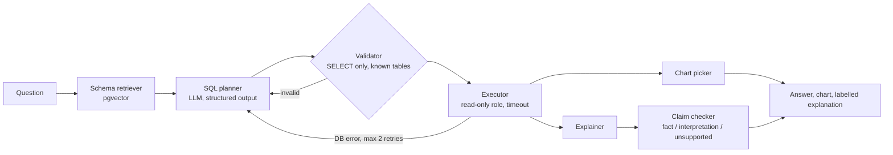

# QueryPilot

Ask your database a question in plain English. QueryPilot writes safe SQL, runs it read-only, shows the answer with a chart, and labels every sentence of its explanation as a **fact** (backed by result rows), an **interpretation**, or an **unsupported causal claim**.

> **Status:** in design (Nov 2026). This README is the build plan; sections fill in as each phase ships.

## Why

Most text-to-SQL demos stop at "the query ran". The harder problems are trust problems: is the SQL safe, is the number right, and is the explanation claiming more than the data shows? QueryPilot is built around those three questions.

## How it works

1. **Schema retriever** finds the handful of tables and columns relevant to the question.
2. **SQL planner** returns the query, the tables it used and its assumptions.
3. **Validator** parses the SQL and rejects anything that is not a single SELECT on known tables.
4. **Executor** runs it on a read-only role with a timeout and a row limit. Errors go back to the planner, at most twice.
5. **Chart picker** chooses a table, bar or line chart by rule.
6. **Claim checker** checks every number in the explanation against the result and labels each sentence.

## Phases

- [ ] **1. NL to SQL:** connect a database, generate SQL, run it read-only, show the query
- [ ] **2. Explain and visualise:** plain-language answers, automatic charts, history
- [ ] **3. Reliable agent:** schema retrieval, SQL validation, error-driven repair, fact vs interpretation labels, honest refusals
- [ ] **4. Evals and write-up**

## Evals

| Test set | Measured |
|---|---|
| 50 hand-written questions on a demo e-commerce database | Execution accuracy, repair success rate, refusal correctness |
| A slice of a public text-to-SQL benchmark | Execution accuracy by schema size |
| Labelled explanations | Claim-label accuracy |
| Instructions planted inside data values | Unsafe statements executed (target: zero) |

Results will be published in `evals/results.md` and a smoke set rerun on every push.

## Safety

Read-only database role · SQL allow-list enforced by a parser, not a prompt · no string-built SQL from user input · connection strings encrypted at rest · data values treated as data, never as instructions

## Stack

Python · FastAPI · Claude API · sqlglot · Postgres with pgvector · DuckDB · Next.js · Docker · GitHub Actions

Architecture, repository structure and database plan: [docs/ARCHITECTURE.md](docs/ARCHITECTURE.md)

---
Mariyam Pangarkar · [LinkedIn](https://linkedin.com/in/mariyam-pangarkar) · [Portfolio](https://mariyampangarkar19.github.io)
