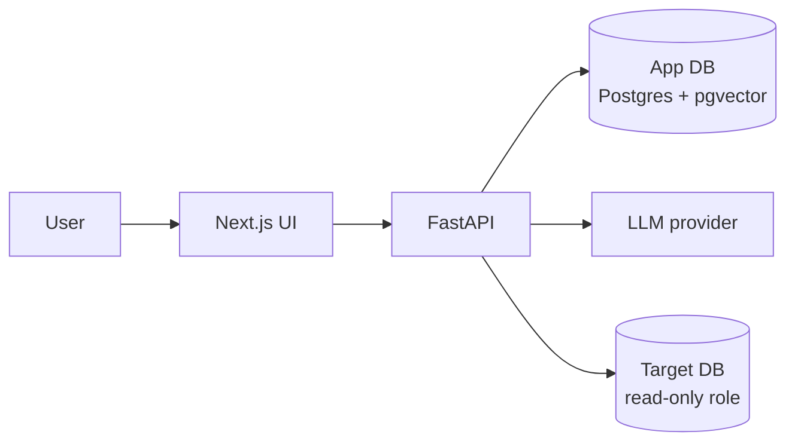

# QueryPilot: architecture

Status: locked for v1 (Nov 2026). Changes go through a short decision record in `docs/decisions/`.

## Principles this design follows

1. **Separation of concerns.** HTTP handling, business logic, LLM calls and data access live in separate layers. A route never talks to the database or the model directly.
2. **Dependencies point inward.** `domain` knows nothing about FastAPI, Postgres or any LLM vendor. Outer layers (API, adapters) depend on inner ones, never the reverse.
3. **Ports and adapters.** Every external system (database, LLM, third-party API) sits behind a small interface, so it can be swapped or faked in tests.
4. **The LLM is an untrusted component.** Its output is validated by ordinary code before anything acts on it. Safety rules are enforced in code, not in prompts.
5. **Stateless services, state in the database.** Any process can be restarted or scaled without losing work.
6. **Idempotent writes.** Reprocessing the same input never creates duplicates.
7. **Observable by default.** Every request and every model or tool call is logged with latency and cost.
8. **Start as a modular monolith.** One deployable service with clear module boundaries; split out a service only when a real need appears.

## Technology decisions

| Layer | Choice | Why |
|---|---|---|
| Backend language | Python 3.12 | Best LLM and data tooling; typed with Pydantic and mypy |
| API framework | FastAPI | Async, typed request and response models, OpenAPI for free |
| Frontend | TypeScript, Next.js (App Router), Tailwind, shadcn/ui | Typed end to end; server components keep API keys off the client |
| Charts | Vega-Lite | A chart is a JSON spec the backend can produce and validate |
| App database | PostgreSQL 16 with pgvector | One database for relational data and schema embeddings |
| Target databases | PostgreSQL and DuckDB | Postgres for realism, DuckDB for a zero-setup demo |
| SQL parsing | sqlglot | Dialect-aware parser for the validator |
| LLM | Claude API behind an `LLMClient` port | Structured outputs; vendor swappable |
| ORM and migrations | SQLAlchemy 2 (async), Alembic | Explicit, versioned schema changes |
| Packaging | uv, Docker | Reproducible builds |
| CI | GitHub Actions: ruff, mypy, pytest, eval smoke set | Quality gate on every push |
| Hosting | API on Fly.io or Render, UI on Vercel, DB on Neon | Free or near-free tiers |

## System context



There are two databases and they must never be confused: the **app database** (QueryPilot's own state) and the **target database** (the user's data, which QueryPilot may only read).

## Repository structure

```
querypilot/
  backend/
    app/
      api/            # FastAPI routers, request/response schemas, auth
      domain/         # pure logic: Question, SqlPlan, Claim, ChartSpec, policies
      services/       # use cases: ask.py, index_schema.py, feedback.py
      pipeline/       # retriever, planner, validator, executor, repair, explainer, claim_checker, chart_picker
      adapters/
        llm/          # LLMClient port + Claude implementation + fake for tests
        targets/      # TargetDatabase port + postgres.py, duckdb.py
        repo/         # SQLAlchemy repositories for the app DB
      prompts/        # versioned prompt files (planner.v1.md, explainer.v1.md)
      core/           # config, logging, tracing, errors
    migrations/       # Alembic
    tests/            # unit (domain, pipeline with fakes), integration (real Postgres)
  frontend/
    app/              # routes: /, /connections, /history
    components/       # QuestionBox, SqlPanel, ResultTable, Chart, LabelledExplanation
    lib/              # typed API client generated from OpenAPI
  evals/
    datasets/         # questions + gold SQL + gold results
    run.py            # runs a config against a dataset
    results.md
  docs/               # this file, decisions/, system-card.md
  infra/              # Dockerfiles, docker-compose.yml, CI
```

## The ask pipeline

Each stage is a plain function with typed input and output, so stages are unit-tested alone and ModelBench can switch them on and off.

| Stage | Input | Output | Fails how |
|---|---|---|---|
| Retriever | question, connection | relevant tables and columns | returns the full schema if small |
| Planner (LLM) | question, schema slice | `SqlPlan{sql, tables_used, assumptions, answerable}` | `answerable=false` ends with an honest refusal |
| Validator | SqlPlan | validated SQL with LIMIT | rejects non-SELECT, unknown tables, multiple statements |
| Executor | SQL | rows, column types | timeout or DB error |
| Repair | error, previous plan | new SqlPlan | stops after 2 attempts |
| Chart picker | column types, row count | Vega-Lite spec or "table" | falls back to a table |
| Explainer (LLM) | question, rows | draft explanation | |
| Claim checker | explanation, rows | claims labelled fact, interpretation or unsupported | a number that does not match the rows is marked unsupported |

## Database plan (app database)

```sql
CREATE TABLE users (
  id            uuid PRIMARY KEY DEFAULT gen_random_uuid(),
  email         citext UNIQUE NOT NULL,
  created_at    timestamptz NOT NULL DEFAULT now()
);

CREATE TABLE connections (
  id            uuid PRIMARY KEY DEFAULT gen_random_uuid(),
  user_id       uuid NOT NULL REFERENCES users(id) ON DELETE CASCADE,
  name          text NOT NULL,
  dialect       text NOT NULL CHECK (dialect IN ('postgres','duckdb')),
  dsn_encrypted bytea NOT NULL,              -- envelope-encrypted, key in env
  indexed_at    timestamptz,
  UNIQUE (user_id, name)
);

CREATE TABLE schema_chunks (               -- one row per column of the target DB
  id            bigserial PRIMARY KEY,
  connection_id uuid NOT NULL REFERENCES connections(id) ON DELETE CASCADE,
  table_name    text NOT NULL,
  column_name   text NOT NULL,
  data_type     text NOT NULL,
  description   text,
  sample_values jsonb,
  embedding     vector(1024) NOT NULL,
  UNIQUE (connection_id, table_name, column_name)
);
CREATE INDEX ON schema_chunks USING hnsw (embedding vector_cosine_ops);

CREATE TABLE queries (
  id            uuid PRIMARY KEY DEFAULT gen_random_uuid(),
  connection_id uuid NOT NULL REFERENCES connections(id) ON DELETE CASCADE,
  question      text NOT NULL,
  final_sql     text,
  status        text NOT NULL CHECK (status IN ('answered','refused','failed')),
  attempts      smallint NOT NULL DEFAULT 1,
  row_count     integer,
  chart_spec    jsonb,
  latency_ms    integer,
  cost_usd      numeric(10,6),
  prompt_version text NOT NULL,
  created_at    timestamptz NOT NULL DEFAULT now()
);
CREATE INDEX ON queries (connection_id, created_at DESC);

CREATE TABLE query_attempts (              -- every SQL tried, including repairs
  id            bigserial PRIMARY KEY,
  query_id      uuid NOT NULL REFERENCES queries(id) ON DELETE CASCADE,
  attempt_no    smallint NOT NULL,
  sql           text NOT NULL,
  validator_ok  boolean NOT NULL,
  error         text,
  UNIQUE (query_id, attempt_no)
);

CREATE TABLE claims (
  id            bigserial PRIMARY KEY,
  query_id      uuid NOT NULL REFERENCES queries(id) ON DELETE CASCADE,
  position      smallint NOT NULL,
  text          text NOT NULL,
  label         text NOT NULL CHECK (label IN ('fact','interpretation','unsupported_causal')),
  evidence      jsonb                       -- row and column references for facts
);

CREATE TABLE feedback (
  query_id      uuid PRIMARY KEY REFERENCES queries(id) ON DELETE CASCADE,
  rating        smallint NOT NULL CHECK (rating IN (-1, 1)),
  note          text,
  created_at    timestamptz NOT NULL DEFAULT now()
);
```

Rules: result rows are **not** stored (only counts and the chart spec), so user data never accumulates in the app database. All schema changes go through Alembic migrations.

### Target database access

A dedicated role per connection: `GRANT SELECT` only, `default_transaction_read_only = on`, `statement_timeout = 10s`. The validator is the first line of defence and the role is the second, so a validator bug still cannot write.

## API

| Method and path | Purpose |
|---|---|
| `POST /connections` | Register a target database and index its schema |
| `POST /ask` | Run the pipeline; returns SQL, rows, chart spec, labelled claims |
| `GET /queries?connection_id=` | History |
| `POST /queries/{id}/feedback` | Thumbs up or down |
| `GET /healthz` | Liveness |

## Key decisions

- **No agent framework in v1.** The pipeline is a fixed sequence with one bounded loop, so plain functions are clearer than a graph library.
- **Rules before LLM for charts.** Deterministic, free and testable.
- **Parser-enforced safety.** "Only SELECT" is checked on the parsed syntax tree, never by asking the model to behave.
